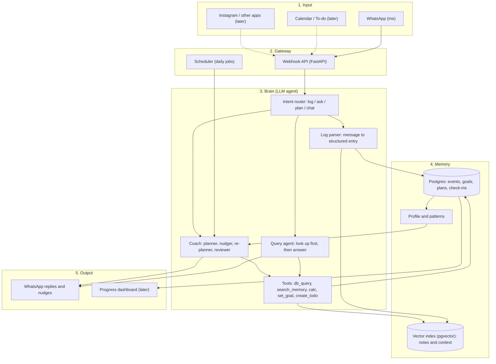

# Personal Life Assistant: High-Level Design

Status: Draft v0.1
Owner: Priya
Channel for v1: WhatsApp

---

## 1. What is this?

A personal assistant that knows my goals, logs everything I do with the exact date and time, makes plans, nudges me daily, and remembers my history.

The main idea: **the assistant keeps a dated diary and looks things up in it before it answers.**
Most chat tools remember facts about you, but they cannot answer "what did I do on 8 Nov?" or "how many gym days did I miss in October?". This project fixes that.

## 2. Goals and non-goals

**Goals (v1)**
- Log anything I send on WhatsApp (text first, voice later) with a timestamp.
- Answer questions about my past with real dates ("10 days ago you did X").
- Hold my goals (yearly, monthly, weekly) and track progress.
- Send a morning plan and an evening check-in.
- Give a weekly summary.
- Be something I actually use every day.

**Non-goals (for now)**
- Reading Instagram or WhatsApp chats automatically. Access is limited and has privacy rules. Manual logging first.
- Multiple users. This is a single-user tool.
- A fancy mobile app. WhatsApp is the app.

## 3. Example things I will say to it

| I send | What happens |
|---|---|
| "ate 2 rotis and dal for lunch" | Saved as a food entry with time and rough calories |
| "gym 45 min, legs" | Saved as an exercise entry, counts toward my gym goal |
| "read 2 research papers" | Saved as a learning entry |
| "posted reel on Instagram" | Saved as a content entry, counts toward my posting goal |
| "what did I do last Tuesday?" | It searches the log and replies with a dated list |
| "I'm sick this week" | It lowers my weekly targets and tells me the new plan |

## 4. Architecture

## 5. Components

**Input**
- WhatsApp Business Cloud API (by Meta) sends each message to my webhook.
- Calendar, to-do and social apps are added in later versions.

**Gateway**
- A small web service receives messages, checks they come from my number only, and passes them to the brain.
- A scheduler runs timed jobs: morning plan, evening check-in, weekly review.

**Brain**
- **Intent router:** decides if the message is a log, a question, a plan request, or normal chat.
- **Log parser:** turns "gym 45 min, legs" into a clean record (category, what, minutes, time). If something is unclear, it asks me one short question.
- **Query agent:** for any question about my past, it must call the database tools first and answer only from what it finds. It always shows the date.
- **Coach:** builds plans from goals, writes nudges, re-plans when life changes, and writes reviews.
- **Tools:** the brain does not guess numbers. It uses code and database queries for counts, averages and streaks.

**Memory** (two kinds, used together)
- **Exact memory (Postgres):** dates, numbers, goals, plans. Answers "how many", "when", "how often".
- **Fuzzy memory (vector search):** notes, feelings, context. Answers "remind me when I felt low on energy".
- **Profile and patterns:** built from the log, for example "skips gym after late work days". Used to make better plans.

**Output**
- Replies and nudges on WhatsApp.
- A simple progress dashboard later.

## 6. Main flows

**A. Logging**
1. I send a message on WhatsApp.
2. The webhook receives it and saves the raw message with a timestamp.
3. The parser makes structured entries and links them to a goal if one matches.
4. The assistant replies with a short confirmation, for example "Logged: gym, 45 min. That's 3 of 4 this week."

**B. Asking about the past**
1. I ask "what did I do 10 days ago?"
2. The router sends it to the query agent.
3. The agent works out the date, queries the log, and reads the results.
4. It replies with the facts and the date, then suggests what to do now.

**C. Daily nudge**
1. The scheduler wakes up each morning.
2. The coach reads today's goals, recent progress, my calendar, and patterns.
3. It sends a short plan. In the evening it asks for a check-in and marks what is done.

**D. Re-planning**
1. I tell it about an event (sick, travel, a deadline).
2. The coach compares it with my goals and lowers or moves targets.
3. It sends the new realistic plan and saves the change, so history shows why.

## 7. Data model (overview)

Details go in the low-level design. Main tables:

- `messages`: raw messages in and out, with timestamp
- `events`: the daily log. Fields: time, category, description, numbers (JSON), source message, goal link
- `goals`: title, level (year, month, week), target, start and end date, status
- `plans`: daily and weekly tasks created from goals
- `checkins`: daily and weekly progress snapshots
- `notes`: free text with an embedding, for fuzzy search
- `profile_facts`: patterns learned from the log, with evidence

Rule: **every record has a timestamp in my time zone (Asia/Kolkata), and nothing is deleted without being marked.**

## 8. WhatsApp: what to know

- I need the Meta WhatsApp Business Cloud API: a Meta developer account, a test or business phone number, and a public HTTPS URL for the webhook.
- The business number cannot be the same number already used on my normal WhatsApp app. For the POC, I can use Meta's free test number and add my own number as an allowed recipient.
- **The 24-hour rule:** the assistant can reply freely only within 24 hours of my last message. For nudges outside that window, WhatsApp needs pre-approved message templates, and these can have a small cost.
  - Plan for v1: send my first message of the day (even "hi"), so the window stays open. Add templates for the morning nudge once the rest works.
- Please check Meta's current pricing and rules before building, because they change.
- Backup option for fast testing: Twilio's WhatsApp sandbox.

## 9. Tech choices (simple first)

| Part | Choice | Why |
|---|---|---|
| Language | Python | Fast to build, my main language |
| Web service | FastAPI | Small and simple |
| Database | Postgres with pgvector | One database for exact and fuzzy memory |
| LLM | Claude API with tool use | Good at structured output and tools |
| Scheduler | APScheduler (or cron) | Enough for daily jobs |
| Hosting | One small cloud VM or a simple platform (Railway, Fly.io) | Cheap and easy |
| Config | `.env` file, never committed | Keeps keys safe |

## 10. Privacy and safety

- Single user: the webhook ignores any number except mine.
- Secrets live in environment variables, never in the repo.
- The database is encrypted at rest and backed up daily.
- Health and personal data stays in my own database. I will check what is sent to the LLM provider and keep it to what is needed.
- The assistant gives coaching, not medical advice, and should say so when asked health questions.
- Everything in this repo is built from scratch for personal use, with my own code, data and accounts.

## 11. How I will know it works

- **Memory tests:** add fake entries, ask about "10 days ago", and check the answer matches the log exactly.
- **Parser tests:** a set of sample messages with the expected structured result.
- **Math tests:** streaks and weekly totals match a plain calculation.
- **Real use:** I use it daily for 2 to 3 weeks and keep notes on what annoys me.
- **Nudge quality:** track how often I reply to a nudge. If it is low, nudges are too many or badly timed.

## 12. Roadmap

| Version | Scope |
|---|---|
| v0.1 | Repo, docs, WhatsApp webhook that echoes messages |
| v1 | Logging with timestamps, "what did I do on X" questions |
| v2 | Goals, plans, morning and evening check-ins, weekly summary |
| v3 | Re-planning, calendar and to-do sync, voice notes |
| v4 | Instagram and other apps, pattern insights, dashboard |

## 13. Open questions

- Which time should the morning and evening nudges go out?
- Which goals do I start with? (Suggestion: 3 to 5 only.)
- How detailed should food logging be: rough calories or just a description?
- Where to host the first deployment?

## 14. Next documents

- `02_low_level_design.md`: tables, API endpoints, prompts, tool definitions
- `03_whatsapp_setup.md`: step-by-step Meta setup
- `04_evaluation_plan.md`: test cases and success numbers
